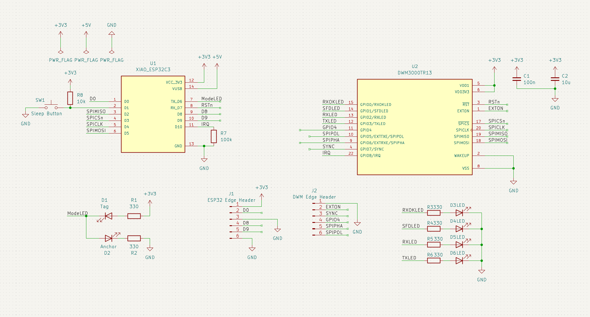
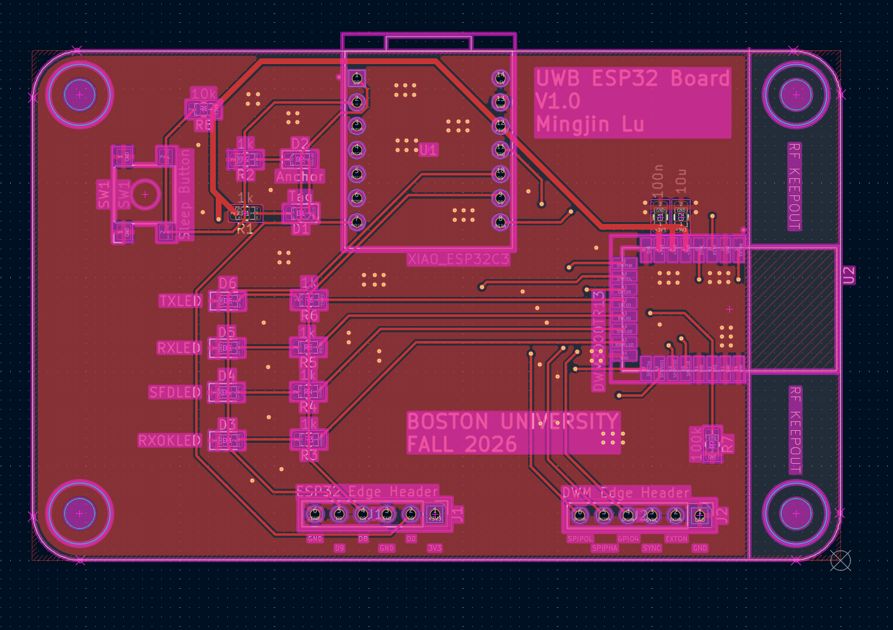

# Sprint 2

## Schematic drawing

The [KiCad schematic](../sch/uwm_esp32/uwm_esp32.kicad_sch) now defines one core board intended to support either the tag or anchor role. The schematic uses a single GPIO to indicate the selected role.

The design includes:

- SPI connections between the XIAO ESP32C3 and DWM3000, plus radio reset and IRQ.
- A common 3.3 V supply and ground, with C1 = 100 nF and C2 = 10 µF for local decoupling.
- Two opposite-state Tag/Anchor LEDs controlled by one MCU GPIO, each with its own series resistor.
- Four radio activity LEDs for RXOK, SFD, RX, and TX, each with a separate series resistor.
- An active-low sleep/wake button with a 10 kΩ external pull-up.
- A 100 kΩ IRQ pull-down to define the input level while the radio sleeps.

The board takes power through the XIAO power pins.

### Pin assignments

The [wiring reference, revision 1.3](../sch/uwb_pin_connections.md) records the schematic connections, connector numbering, and firmware requirements.

| Function | XIAO pin | ESP32-C3 GPIO | Required behavior |
| --- | --- | ---: | --- |
| SPI MISO | D2 | 4 | SPI input |
| SPI MOSI | D5 | 7 | SPI output |
| SPI clock | D4 | 6 | SPI clock |
| SPI chip select | D3 | 5 | Active-low; use SPI Mode 0 |
| DWM3000 reset | D7 | 20 | Open-drain: pull LOW or release |
| DWM3000 IRQ | D10 | 10 | Active-high input; external 100 kΩ pull-down |
| Tag/Anchor LEDs | D6 | 21 | LOW = Tag; HIGH = Anchor |
| Sleep/wake button | D1 | 3 | Active-low input; external 10 kΩ pull-up |

Reset moved to GPIO20 and the mode LEDs moved to GPIO21. This avoids UART0 TX boot messages driving the radio reset line, although the LEDs may flicker during startup. Firmware must configure reset as open-drain and avoid subsequently enabling UART0 on these pins.

The current schematic is the source for connection assignments; the wiring reference documents the October 27 revision and has not incorporated the later resistor-value change described below. In particular, commit `277c92e` is titled “Add IRQ pull-up,” but the current circuit uses an IRQ **pull-down**. Older pin definitions and intermediate commit titles should not be used as the current wiring specification.

### Expansion headers

The former test-point symbols were replaced by two 1×6, 2.54 mm headers:

| Header | Signals in connector pin order, 1–6 | Intended use |
| --- | --- | --- |
| J1 — ESP32 Edge Header | +3V3, D0/GPIO2, GND, D8/GPIO8, D9/GPIO9, GND | MCU expansion and probing |
| J2 — DWM Edge Header | GND, EXTON, SYNC, DWM GPIO4, SPIPHA, SPIPOL | Radio expansion and synchronization experiments |

J1 exposes MCU strapping pins, so attached circuits must preserve the required startup levels. J2 exposes radio signals rather than spare ESP32 GPIOs; external equipment must respect their direction and startup behavior. The SYNC pin is accessible for future anchor timing experiments.

### November 11 resistor revision

Commit `d1c8b9b` changed R1–R6 from **1 kΩ to 330 Ω** in the schematic and saved a dated KiCad backup. The PCB and wiring reference still list 1 kΩ.

## PCB layout

The [PCB layout](../sch/uwm_esp32/uwm_esp32.kicad_pcb) contains:

- Front and back copper layers on a nominal 1.6 mm board.
- An approximately **85.60 × 53.98 mm** rounded rectangular outline and four M3 mounting-hole footprints.
- Placed MCU, UWB module, headers, button, LEDs, resistors, and capacitors.
- Copper tracks, vias, ground pours on both copper layers, and a keep-out area beside the UWB module.
- Revised routing for D0, IRQ, and SPI, plus adjustments to ground-via placement.
- XIAO through-hole pads sized at 1.6 mm with 1.0 mm drills, reflected in the local XIAO footprint as well as the board.

The repository also includes the [custom symbol library](../sch/uwm_esp32.kicad_sym), [XIAO footprint](../sch/uwm_esp32/uwb_esp32.pretty/MODULE_XIAO_ESP32C3.kicad_mod), [DWM3000 footprint](../sch/uwm_esp32/uwb_esp32.pretty/XCVR_DWM3000TR13.kicad_mod), and [project footprint-library table](../sch/uwm_esp32/fp-lib-table). The table uses `${KIPRJMOD}` to locate the footprint library within the project.

The October 27 layout revisions cover component placement, pad and drill sizes, routing, and ground pours. See commits `f6708a4`, `ac58d68`, `2377b3c`, `ca693e3`, `6e1b214`, `be9c92e`, `028a430`, `f86ac31`, and `421d775`.

## JLCPCB order

Ordered **five bare V1.0 shared tag/anchor PCBs** from JLCPCB on **October 27, 2026 at 18:56:55**, as shown in the order record. The PCB prototype order was `Y2-6541022A`, under batch `W2026102806566649`. The order listed a **3-day build time** and showed **Shipped** via Global Standard Direct Line.

The fabrication archive, `gerbers_Y2.zip`, contains the `uwm_esp32` front and back copper, solder mask, and silkscreen Gerbers, the `Edge_Cuts` outline, the Gerber job file, and separate plated and non-plated drill files. It also contains JLCPCB manufacturing files and board previews.

| Fabrication option | Order specification |
| --- | --- |
| Board format | One design, delivered as five individual boards |
| Board outline | 85.60 × 53.98 mm in KiCad, listed as 85.6 × 54 mm in the order. Regular outline tolerance ±0.2 mm. |
| Material and stackup | FR-4 TG135, 2 layers, 1.6 mm thick, 1 oz outer copper, standard stackup |
| Solder mask and silkscreen | Green solder mask and white inkjet silkscreen |
| Surface finish and vias | OSP, tented vias, 0.30 mm minimum via hole with 0.40/0.45 mm via diameters as listed |
| Inspection and marking | Full flying-probe electrical test, IPC Class 2 appearance, and removal of the fabrication mark |
| Quantity requirement | Full quantity required |

| Charge | USD |
| --- | ---: |
| Five PCBs | $2.64 |
| Shipping | $3.12 |
| Sales tax | $0.17 |
| **Order total** | **$5.93** |
