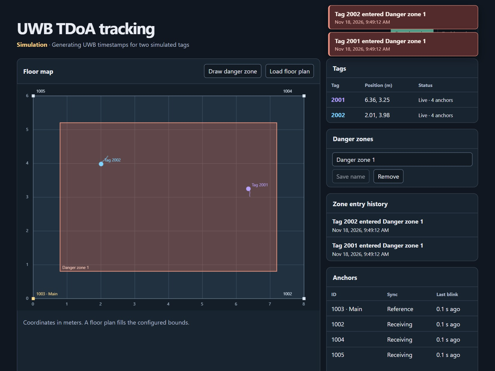

# Sprint 3–4 Progress Report

After the [Sprint 2 design and fabrication order](SPRINT2.md), work moved to board assembly, ESP-IDF firmware, and ranging. The Windows TWR dashboard displays live distances from two tags through one anchor over either Wi-Fi or USB and saves timestamped CSV sessions. The uplink TDoA dashboard plots and replays positions and logs danger-zone entries in simulation. A surveyed two-anchor TDoA bench run reached 97.01% matched reception, with a 2.778 ns 95th-percentile absolute timing residual against the 1 ns target. TWR accuracy and live TDoA map positioning still need validation.

## November 14, 2026 bench log

### Assembly and firmware setup

- Populated the [Sprint 2 PCB](SPRINT2.md) by soldering the DWM3000 and attaching the XIAO ESP32C3. Two ESP32-C3 boards were connected to the Windows PC over USB for the ranging test.
- Installed ESP-IDF v6.1 and Espressif's VS Code extension v2.3.0 in the `ESPIDF` profile. The [firmware project](../firmware/README.md) targets `esp32c3` with 4 MB flash and uses the native USB Serial/JTAG console. The starter build and final ranging build both passed. Verified the final application in flash on both boards.
- The second board initially ran an Arduino build on the ESP32-C3. Both boards ran the ESP-IDF project by the time of the ranging test. The initial USB test used the roles listed below.

### DWM3000 SPI and SW1

- The starter SPI diagnostic backed up the original `COM3` flash before programming. It reset the DWM3000 via open-drain GPIO20 and read `0xDECA0302` five times at 1 MHz in SPI mode 0. Both boards later returned that same chip-model ID. The ESP32-C3 runs the driver and controls the DWM3000 over SPI.
- SW1 on `COM3` uses active-low GPIO3. The pin initially read LOW at startup. Enabling the ESP32-C3's internal pull-up restored the HIGH idle state and allowed the physical switch to report three short presses (150, 160, and 190 ms) and one long press (2,830 ms). The [button diagnostic](../firmware/README.md#sw1-button-test) uses 30 ms debounce and reports the duration on release. The long-press threshold is 1,000 ms. The PCB's external pull-up path still needs an electrical check.

### Wi-Fi configuration

- The [configuration dashboard](../firmware/README.md#wi-fi-configuration-dashboard) runs at `http://192.168.4.1` on each board's setup network. It lets the user edit the role, label, and Node ID and saves them to flash. A role change updates the mode LED output and takes effect in the ranging task between exchanges.
- The setup SSID uses the last six hexadecimal digits of the ESP32 Wi-Fi MAC and stays the same when the label changes. The default Node ID comes from the last two MAC bytes, with a fallback for reserved values. Assign a distinct Node ID to each board. The dashboard displays the ESP32 MAC and the DWM3000 chip-model ID for diagnostics.
- Tested the dashboard from the PC on `COM3`. It rejected invalid values and reloaded a saved role, label, and Node ID after reboot. Later switched the project to a shared bench Wi-Fi password and verified the PC could reconnect to `COM3` and read its settings. Windows could see both access points during ranging setup. Assigned `COM4` its Anchor role over USB when the PC could not connect to its dashboard and verified that the role persisted after loading the standard firmware.

### Two-board UWB ranging

| USB port | ESP32 MAC suffix | Setup SSID | Role | Node ID |
| --- | --- | --- | --- | ---: |
| `COM3` | `BA:EC` | `UWM-FABAEC` | Tag | 47852 |
| `COM4` | `F2:AC` | `UWM-FAF2AC` | Anchor | 62124 |

- Integrated the [DW3110 driver](../firmware/components/dw3110/README.md) at pinned revision `67dfbb7`. The double-sided two-way ranging (DS-TWR) exchange uses UWB channel 5. The tag sends a poll, the anchor responds, the tag sends a final frame, and the anchor reports its timing intervals. The tag computes distance from both radios' hardware timestamps.
- Fixed a startup fault by initializing the driver's private state before reading radio status through the driver. Keeping the anchor receiver enabled between host polls resolved the repeated missed exchanges.
- In the initial logged run, the first attempt timed out during startup. Then both serial logs matched for **25 consecutive exchanges**, sequence numbers 1–25. The tag reported a median of **0.704 m** and a range of **0.633–0.800 m**. The physical separation was unmeasured and antenna delays used nominal values, so accuracy remains unverified.
- To repeat the [ranging test](../firmware/README.md#two-way-ranging), power both boards and open **ESP-IDF: Monitor Device** on the tag at 115200 baud. The tag publishes estimates about once a second and the anchor logs matching replies.
- A follow-up capture swapped the roles. COM4 (tag 62124) and COM3 (anchor 47852) had **63 consecutive matching sequence numbers (58–120)** in the overlapping portion of the logs. The tag reported **0.186–0.273 m** in that interval. The separation was unmeasured. The source captures are `COM4-usb-console-check.log` and `COM3-sequence-check.log` in the local bench workspace.

## November 15, 2026 design checks

The first review used KiCad CLI 9.0.2, which failed to load the KiCad 10 schematic and PCB. A later run with KiCad 10.0.3 checked local copies that matched the repository files byte for byte. The electrical rules check reported **29 warnings**. The design rules check reported **six errors** (five antenna keep-out violations and one incomplete thermal relief) and **19 warnings**. The reports are `erc.json` and `drc.json` in the local bench workspace's `.sprint2-build` directory.

## November 15, 2026 live TWR over Wi-Fi

- Added **Live TWR distance** to the tag's Wi-Fi dashboard. The tag forwards four DW3110 timing intervals plus the node IDs and exchange sequence. The computer's browser calculates double-sided TWR distance in meters and clears the reading once the last sample is at least three seconds old. The tag's serial estimate can be matched by sequence during a bench run.
- The bench test uses one tag and one anchor. Load the updated firmware on the tag, connect the computer to the tag's Wi-Fi, and compare the browser readings at measured antenna-to-antenna separations. Record the ground-truth distances, observed range errors, and whether the display clears when the anchor stops replying. See the [wireless bench procedure](../firmware/README.md#two-way-ranging).
- The ESP-IDF 6.1 build passed. The browser logic passed simulated responses for a 0.704 m reference case, stale data, a disconnected link, and recovery. Hardware checks followed on November 17–18.

## November 17, 2026 local ranging log

The [local ranging log](../firmware/README.md#local-ranging-log) retains up to **2,048 records** per board in a dedicated flash partition and overwrites the oldest as it fills. Each board's dashboard can export those records as CSV. Tag records store all four TWR timing intervals and the distance estimate. Anchor records store the anchor intervals and the lower 32 bits of the poll RX, response TX, and final RX timestamps. Both store node IDs and the exchange sequence. Firmware `0a44c59` built successfully with the custom partition table, and flash verification passed on `COM3`, `COM4`, and `COM5`. A controlled power-cut and CSV readback test for the on-board log remains open.

## November 17–18, 2026 multi-tag ranging and computer dashboard

### Sharing an anchor and selecting a target

- Adding a second tag reproduced a run of 10 consecutive incomplete exchanges on `COM4`. The firmware now keeps listening for the expected reply after receiving an unrelated frame. Tags vary the poll interval and retry once after a randomized delay when an exchange fails. In a 45-second bench run with both tags active, `COM4` completed **43 of 43** attempts and `COM5` completed **45 of 46**. These counts describe that bench run.
- Added **Target Anchor ID** to the tag's Wi-Fi settings. A configured tag addresses its polls to that anchor. Clearing the field selects broadcast ranging. Hardware verified ranging to anchor `1002`, persistence after a tag reboot, and an empty distance display for an unavailable target. Switching between two simultaneously active anchors remains open.

### Anchor gateway and bench results

| Board | Gateway test role | Node ID | Setup SSID |
| --- | --- | ---: | --- |
| `COM4` | Reference anchor | 1003 | `UWM-FAF2AC` |
| `COM5` | Tag on separate power during verification | 1001 | `UWM-FABA08` |
| `COM3` | Second tag | 1002 | `UWM-FABAEC` |

- After DS-TWR completes, the tag sends its calculated distance back to the anchor in a fifth UWB frame. The anchor matches the result to the tag and exchange sequence, keeps the latest result for up to **32 tags**, and forwards readings over USB Serial/JTAG or exposes them through `GET /api/twr/tags` on its setup Wi-Fi.
- The [computer dashboard](../computer/README.md) displays each tag's distance, source, and freshness for the selected reference anchor. It marks readings stale after **three seconds**. Windows received live readings for tags `1001` and `1002` through anchor `1003` using each transport. Tag `1001` ran on separate power and was absent from the PC's USB port list. The collector opened only the anchor connection in each test.
- **Start logging** opens a timestamped CSV under `computer/logs/`. **End logging** closes it and displays the saved path and row count. Each row includes UTC receive time, tag ID, anchor ID, sequence, distance in meters, and connection source. A live test wrote three readings to a temporary CSV, confirmed that the file stopped changing after ending the session, and opened a different CSV for a second session.

#### Successful TWR distance log

The saved November 18 capture `computer/logs/twr-20261118T053643.673696Z.csv` contains 19 distance estimates delivered through anchor `1003` over USB (`COM4`). Sequence numbers are per tag.

| Tag | Recorded ranges | Sequences | Distance estimates |
| --- | ---: | --- | ---: |
| 1001 | 9 | 181–189 | 0.762–0.818 m |
| 1002 | 10 | 29–38 | 0.800–0.845 m |

The first four log rows were tag `1001` sequence 181 at 0.767 m, tag `1002` sequence 29 at 0.836 m, tag `1001` sequence 182 at 0.802 m, and tag `1002` sequence 30 at 0.805 m. The estimates are uncalibrated. Ground-truth separations and the total number of attempts are unavailable for this CSV.

### USB anchor discovery and final TWR flash

- The collector was initially restricted to `COM4`, so it missed the newly connected anchor on `COM3`. The dashboard was restarted with USB auto-discovery. The firmware now announces the board's role and Node ID over USB every two seconds, allowing idle anchors to appear before receiving a tag's range. A hardware check showed both `1002` and `1003` in the reference list while anchor `1002` was idle. Reconnect and replacement on the same port were checked with simulated serial devices.
- Flashed and verified the latest TWR application on all three boards. After reboot, the dashboard identified `COM3` as tag `1002`, `COM4` as anchor `1003`, and `COM5` as tag `1001`. Anchor `1003` resumed reporting live distances from both tags.

## November 18, 2026 computer-side uplink TDoA

- Built a [separate TDoA dashboard and gateway interface](../computer/TDOA.md). The PC reads raw blink and sync timestamps from the main anchor over USB or Wi-Fi, compensates for clock offset and drift using bracketing beacons, and estimates a 2D position at a configured tag height. The floor map displays tag IDs, trails, anchor sync status, and position freshness. A position becomes stale after one second.
- The simulator exercises two moving tags, independent anchor clock drift, and 40-bit timestamp rollover. Tests verified rollover, rejection of a clock bracket across an anchor restart, fragmented USB frames, and Wi-Fi pagination using a simulated gateway. A recorded session reproduced **10 position fixes** on replay and saved **30 corrected arrival-time differences**.
- Each session saves raw events, corrected arrival-time differences, solved positions, and the layout locally. The timing CSV supports the two-anchor bench test before there are enough synchronized anchors for a map fix.

### Danger-zone drawing and notifications

- **Draw danger zone** lets the operator click vertices on the floor map, name the polygon, and save it. A fresh tag position inside the polygon generates an entry notification and a history row. A later entry can generate another notification after a fresh position places the tag outside. Stale positions leave the entry state unchanged.
- A simulated recording saved entry rows for tags `2001` and `2002` to `computer/logs/tdoa-20261118T140914.932940Z/zone-entries.csv`. The current simulator also produced visible notifications and history rows after a zone was drawn through the browser. See [the zone workflow](../computer/TDOA.md#draw-danger-zones).

### Uplink TDoA firmware and two-anchor hardware test

- Added a selectable uplink TDoA mode and a dedicated bench capture path. A tag broadcasts blinks, the main anchor sends sync beacons, and a secondary anchor timestamps both frame types. In selectable mode, the secondary forwards its timestamps to the main anchor over Wi-Fi. The separate bench image and collector use three serial ports to count transmissions and check reception independently. See the [firmware setup](../firmware/README.md#uplink-tdoa) and [bench procedure](../computer/TDOA.md#three-board-timing-bench).
- In the surveyed setup, main anchor `1003` and secondary anchor `1002` were 0.66 m apart. Tag `1001` was 0.66 m from the main and 0.30 m from the secondary. The expected secondary-minus-main arrival difference was −1.201 ns. The radios used nominal antenna delays.

| 65-second bench run | Matched blinks | 95th-percentile absolute timing residual |
| --- | ---: | ---: |
| Polling both anchors | 585/603 (97.01%) | 2.778 ns |
| Interrupt wake-up on both anchors | 545/602 (90.53%) | 3.051 ns |
| Interrupt wake-up on the secondary anchor | 540/598 (90.30%) | 3.300 ns |

The captures verified physical blink reception, clock correction, and timestamp rollover. Polling met the 95% matched reception threshold in this surveyed setup and remains the bench implementation. The surveyed runs exceeded the 1 ns timing limit. With two anchors, the bench measures one arrival-time difference. Live 2D positioning requires a third synchronized anchor and a surveyed map.

## Status of the Sprint 1 user stories

All five tracking acceptance tests remain open.

| Sprint 1 story | Evidence and remaining work |
| --- | --- |
| One tag on an indoor map | The TDoA simulator produces positions on the floor map and marks them stale. Test a physical tag with a surveyed anchor layout and measure position error. |
| Two distinct tracked tags | Two physical tags appeared under separate IDs through one TWR anchor. Two simulated TDoA tags have separate map trails. Test physical crossing paths and per-tag position update rates. |
| Restricted-zone alerts | Polygon drawing, fresh-position entry alerts, history, and CSV logging work in simulation. Add permitted-tag lists and run the full acceptance scenarios with physical tags. |
| Abnormal motion and prolonged signal loss | The map marks stale positions. Implement the speed threshold and prolonged-loss alert, then test both scenarios. |
| Recorded-movement replay | The computer replays simulated TDoA positions from recorded timestamp events. Validate replay with a physical movement session and surveyed reference data. |

The [Sprint 1 browser mockup](../work/uwb-site.tar.gz) shows three anchors, two movable tags, and a danger zone. The Sprint 3–4 Python simulator sends timestamp events through the same PC solver used by the live gateway inputs.

## Remaining work

1. **Resolve the board findings.** Fix the antenna keep-out and thermal relief violations, then rerun the checks. Confirm the intended LED resistor values and DWM3000 GPIO drive limits, and bring the schematic, PCB, and wiring reference into agreement. The wiring review proposed evaluating 2.2–4.7 kΩ for the radio LEDs against the actual components.
2. **Finish electrical bring-up.** Check the external SW1 pull-up, IRQ, LEDs, sleep/wake behavior, and USB supply and continuity. Inspect grounding, decoupling, antenna clearance, connector orientation, and footprint fit. Measure mobile-tag power consumption and battery runtime.
3. **Measure TWR accuracy and validate on-board storage.** Compare readings at measured antenna-to-antenna separations, calibrate antenna delays, and repeat with an obstructed path. Verify the on-board CSV across a controlled power cut. Check anchor selection with two active anchors and measure the update rate and missed results with both tags active.
4. **Reduce TDoA timing error and repeat the surveyed test.** Calibrate antenna delays and compare corrected timing against surveyed geometry at multiple positions. The [Sprint 1 feasibility gate](SPRINT1.md#project-assumption) requires at least **95% matched reception** and a **95th-percentile absolute timing residual of at most 1 ns** at each test position. Document the TWR fallback decision if the gate remains unmet.
5. **Validate live positions and tracking scenarios.** After the timing gate passes, add a third anchor for known-height 2D positioning. Configure the surveyed layout and measure position error on the floor map before testing the second physical tag, freshness, zone alerts, abnormal motion, signal loss, and replay.
